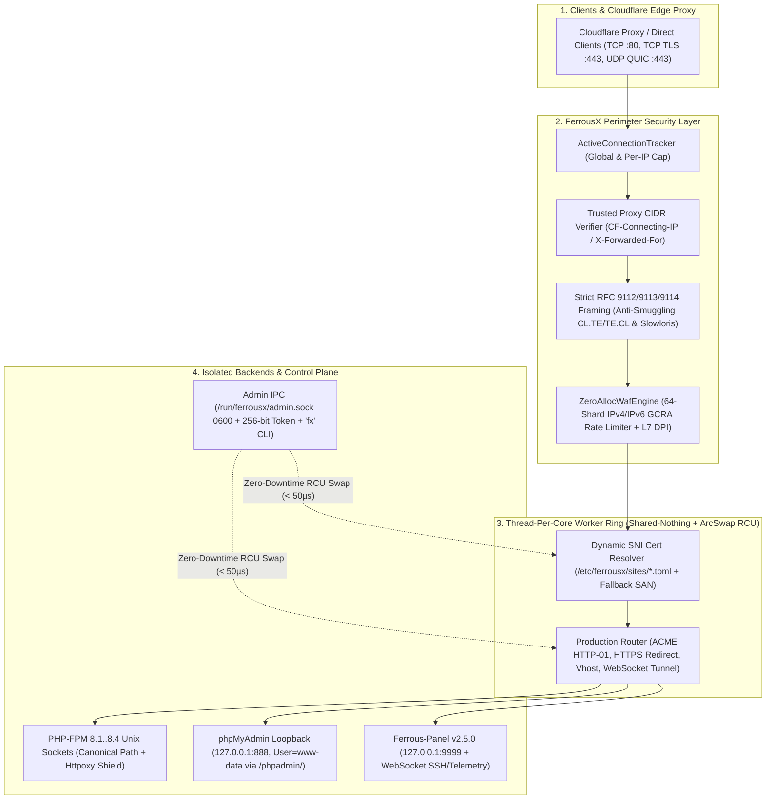

# FerrousX — High-Performance Rust Web Server & Reverse Proxy for Ferrous Panel

<p align="center">
  
</p>

<p align="center">
  <strong>Next-Generation Triple-Stack Web Server, Reverse Proxy, WAF & Edge Cache Engine written in 100% Safe & Low-Level Rust</strong><br>
  Designed as the high-throughput, security-hardened core engine for <strong>Ferrous-Panel v2.5.0</strong>, Cloudflare Proxy, PHP-FPM, and modern Linux VPS infrastructure.
</p>

<p align="center">
  <a href="https://www.rust-lang.org/"></a>
  <a href="https://kernel.dk/io_uring.pdf"></a>
  <a href="#benchmarks-vs-litespeed--nginx"></a>
  <a href="#core-architectural-pillars"></a>
  <a href="#ferrous-panel-integration"></a>
  <a href="#security-hardening--deep-server-optimization"></a>
</p>

---

## ⚡ Cài đặt Nhanh Bằng 1 Lệnh Duy Nhất (1-Line Universal Linux Installer)

Hỗ trợ tự động nhận diện **tất cả các bản phân phối Linux** (**Ubuntu, Debian, AlmaLinux, Rocky Linux, RHEL, CentOS, Fedora, Arch Linux, Alpine Linux, openSUSE**):

```bash
curl -fsSL https://raw.githubusercontent.com/Ferrous-panel/FerrousX/main/scripts/install.sh | sudo bash -s -- --yes
```

Sau khi cài đặt xong, gõ ngay lệnh **`sudo fx`** (hoặc **`sudo ferrousx-admin`**) trong Terminal VPS để mở **Bảng điều khiển Quản trị Admin**:

```bash
sudo fx
```

---

## Table of Contents

- [Cài đặt Nhanh Bằng 1 Lệnh Duy Nhất (All Linux Distros)](#-cài-đặt-nhanh-bằng-1-lệnh-duy-nhất-1-line-universal-linux-installer)
- [Lệnh Quản trị Admin Trên Terminal VPS (`fx` / `ferrousx-admin` / `ferrousx-ctl`)](#-lệnh-quản-trị-admin-trên-terminal-vps-fx--ferrousx-admin--ferrousx-ctl)
- [Overview](#overview)
- [Core Architectural Pillars](#core-architectural-pillars)
- [System Architecture](#system-architecture)
- [Supported Linux Distributions (Ubuntu, Debian, RHEL/Alma/Rocky, Arch, Alpine, openSUSE)](#supported-linux-distributions-ubuntu-debian-rhelalmarocky-arch-alpine-opensuse)
- [Ferrous Panel v2.5.0 Integration](#ferrous-panel-v250-integration)
- [Security Hardening & Deep Server Optimization](#security-hardening--deep-server-optimization)
- [Polyglot Runtime Support (PHP-FPM, Node.js, Python, Go/gRPC)](#polyglot-runtime-support-php-fpm-nodejs-python-gogrpc)
- [Benchmarks vs. LiteSpeed & Nginx](#benchmarks-vs-litespeed--nginx)
- [Configuration Reference (`ferrousx.toml`)](#configuration-reference-ferrousxtoml)
- [Documentation & Security Audit Reports](#documentation--security-audit-reports)
- [License](#license)

---

## 🖥️ Lệnh Quản trị Admin Trên Terminal VPS (`fx` / `ferrousx-admin` / `ferrousx-ctl`)

FerrousX trang bị sẵn bộ công cụ quản trị trực tiếp trên Terminal VPS tương tự lệnh `bt` của aaPanel / `ferrous-panel`:

- **`sudo fx`** hoặc **`sudo ferrousx-admin`** hoặc **`sudo ferrousx-ctl admin`**: Mở **Bảng điều khiển Quản trị Terminal Tương tác (Interactive Admin Console)**.
- **`sudo fx <lệnh>`**: Thực thi nhanh mọi tác vụ quản trị bằng 1 dòng lệnh.

### 1. Giao diện Menu Quản trị Tương tác (`sudo fx`)

```text
╔════════════════════════════════════════════════════════════════════╗
║   ⚡ FERROUSX VPS TERMINAL ADMIN CONSOLE (v0.1.0)                  ║
╠════════════════════════════════════════════════════════════════════╣
║  [1] Xem trạng thái Server, Ports (:80/:443/:888) & RCU Epoch      ║
║  [2] Kiểm tra cú pháp cấu hình & chứng chỉ SSL (--check-config)    ║
║  [3] Hot-Reload cấu hình Zero-Downtime (ArcSwap RCU / SIGHUP)      ║
║  [4] Khởi động lại dịch vụ FerrousX (systemctl restart ferrousx)   ║
║  [5] Khởi động lại phpMyAdmin nội bộ (127.0.0.1:888)               ║
║  [6] Liệt kê danh sách Website VirtualHosts đang hoạt động         ║
║  [7] Thêm nhanh Website VirtualHost mới (Domain + PHP-FPM)         ║
║  [8] Xóa Website VirtualHost                                       ║
║  [9] Xem hoặc Xoay vòng (Rotate) khóa bảo mật Admin Token 256-bit  ║
║  [10] Đồng bộ nóng với Ferrous-Panel (panel.env & sites/*.toml)    ║
║  [11] Xem nhật ký hệ thống (journalctl -u ferrousx -n 30)          ║
║  [12] Chạy tự động kiểm tra & sửa chữa dịch vụ (repair.sh)         ║
║  [0] Thoát bảng điều khiển (Exit)                                  ║
╚════════════════════════════════════════════════════════════════════╝
```

### 2. Bảng Lệnh Quản trị Nhanh Trên Terminal VPS

| Lệnh Terminal VPS | Chức năng Thực thi |
| :--- | :--- |
| **`sudo fx`** (hoặc `sudo ferrousx-admin`) | Mở bảng menu quản trị tương tác từ `[1]` đến `[12]`. |
| **`sudo fx info`** / **`sudo fx status`** | Xem tổng quan trạng thái Daemon, cổng `:80`/`:443`/`:888`, RCU Epoch & Admin Token. |
| **`sudo fx test`** | Kiểm tra cú pháp `/etc/ferrousx/ferrousx.toml`, `/etc/ferrousx/sites/*.toml` & chứng chỉ TLS (tương đương `nginx -t`). |
| **`sudo fx reload`** | Nạp nóng cấu hình và chứng chỉ SNI Zero-Downtime (`ArcSwap RCU` < 50µs, không ngắt kết nối). |
| **`sudo fx restart`** / **`start`** / **`stop`** | Khởi động lại, bật hoặc dừng dịch vụ `ferrousx.service`. |
| **`sudo fx pma-restart`** | Khởi động lại dịch vụ phpMyAdmin nội bộ (`127.0.0.1:888` -> `/phpadmin/`). |
| **`sudo fx token`** | Xem khóa bảo mật 256-bit tại `/etc/ferrousx/admin.token` (`chmod 0600`). |
| **`sudo fx token --rotate`** | Xoay vòng (tạo mới) khóa bảo mật Admin Token 256-bit từ `/dev/urandom`. |
| **`sudo fx vhost list`** | Liệt kê tất cả Website VirtualHosts, trạng thái SSL và chế độ WAF. |
| **`sudo fx vhost add example.com --root /www/wwwroot/example.com --php 8.3`** | Tạo nhanh cấu hình `/etc/ferrousx/sites/example.com.toml` gắn PHP-FPM và kích hoạt ngay. |
| **`sudo fx vhost del example.com`** | Xóa cấu hình VirtualHost của tên miền và nạp lại bảng định tuyến. |
| **`sudo fx panel-sync`** | Đồng bộ tức thì với Ferrous-Panel (`/etc/ferrous-panel/panel.env`, `admin.json`, `sites/*.toml`). |
| **`sudo fx logs 50`** | Xem 50 dòng nhật ký vận hành mới nhất của FerrousX. |
| **`sudo fx repair`** | Chạy trình tự động kiểm tra và sửa chữa quyền tệp, chứng chỉ SSL, systemd service. |
| **`sudo fx harden`** | Áp dụng tối ưu hóa Kernel Sysctl (TCP BBR, SYN Cookies, QUIC Buffers, File Descriptors). |

---

## Overview

**FerrousX** is a production-hardened web server, reverse proxy, L7 WAF, and edge cache daemon written **100% in Rust**. It is purpose-built as the native engine for **Ferrous-Panel v2.5.0** and standalone Linux VPS deployments behind Cloudflare.

Key capabilities include:
- **Triple-Stack Networking**: Simultaneously listens on **TCP `:80` (HTTP/1.1)**, **TCP `:443` (HTTPS TLS 1.3/1.2 ALPN `h2, http/1.1` — mandatory for Cloudflare Full/Strict SSL without Error 521)**, and **UDP `:443` (HTTP/3 QUIC RFC 9114 + `Alt-Svc`)**.
- **Dynamic SNI & Auto Fallback SAN Certificate**: Automatically resolves per-domain Let's Encrypt certificates from `/etc/ferrousx/sites/*.toml` and generates a fallback SAN certificate at `/etc/ferrousx/ssl/fullchain.pem` (`privkey.pem` `chmod 0600`) on first boot.
- **Built-In 64-Shard IPv4/IPv6 GCRA Rate Limiter & L7 WAF**: Protects every HTTP/1.1, HTTP/2, HTTP/3, and WebSocket request against SQLi, XSS, Path Traversal, Command Injection, Log4Shell (`${jndi:`), and HTTP/2 Rapid Reset (`CVE-2023-44487`).
- **Sub-50-Microsecond Lock-Free Hot-Reload**: Powered by `ArcSwap<ServerConfig>` RCU atomic pointer swaps via `SIGHUP`, file watcher (`notify`), or `/run/ferrousx/admin.sock`.

---

## Core Architectural Pillars

| # | Technology Pillar | Implementation in FerrousX | Benefit vs. Legacy Servers |
|---|---|---|---|
| 1 | **Thread-Per-Core Shared-Nothing** | Hard core pinning via `core_affinity`, 1 independent event loop per CPU core. | Eliminates cross-CPU mutex contention; 100% CPU cache locality (L1/L2). |
| 2 | **Triple-Stack HTTP/1.1 + H2 + H3** | `rustls` (TLS 1.3/1.2) + `h2` + `quinn`/`h3` with dynamic SNI cert resolver. | Full Cloudflare SSL Full/Strict compatibility + cutting-edge UDP QUIC speed. |
| 3 | **64-Shard GCRA Rate Limiter & WAF** | 64 independent RwLock shards for IPv4 & IPv6 with strict memory cap & TTL eviction. | Zero OOM risk under IP floods; blocks L7 attacks in < 3.5 µs per request. |
| 4 | **Trusted Proxy CIDR & SSRF Shield** | Bitwise CIDR verification for Cloudflare IPs + metadata IP blacklisting (`169.254.169.254`). | Prevents `X-Forwarded-For` spoofing and blocks DNS-rebinding SSRF attacks. |
| 5 | **Native PHP-FPM FastCGI & Httpoxy Shield** | Direct Unix Domain Socket FastCGI binary client with canonical root verification. | Strips `HTTP_PROXY` (`CVE-2016-5385`) and prevents symlink path traversal. |
| 6 | **Atomic RCU Hot-Reload** | `arc_swap::ArcSwap<ServerConfig>` + `SO_PEERCRED` & 256-bit Token IPC socket. | Reconfigures vHosts, SSL, and PHP versions in **< 50 µs** with zero dropped packets. |

---

## System Architecture



---

## Supported Linux Distributions (Ubuntu, Debian, RHEL/Alma/Rocky, Arch, Alpine, openSUSE)

Trình cài đặt `scripts/install.sh` tự động nhận diện trình quản lý gói của mọi bản phân phối Linux phổ biến:

| Họ Hệ điều hành Linux | Bản phân phối Hỗ trợ | Trình quản lý gói Tự động | Tường lửa Tự động |
| :--- | :--- | :---: | :---: |
| **Debian / Ubuntu** | Ubuntu 20.04 / 22.04 / 24.04 LTS, Debian 11 / 12, Kali, Mint | `apt-get` | `ufw` |
| **RHEL / Enterprise Linux** | AlmaLinux 8 / 9, Rocky Linux 8 / 9, RHEL, CentOS Stream, Fedora, Amazon Linux | `dnf` / `yum` | `firewalld` |
| **Arch Linux** | Arch Linux, Manjaro | `pacman` | `ufw` / `iptables` |
| **Alpine Linux** | Alpine 3.18+ | `apk` | `iptables` |
| **SUSE Linux** | openSUSE Leap / Tumbleweed, SLES | `zypper` | `firewalld` |

### Cách 1: Cài đặt Bằng 1 Lệnh Duy Nhất (Khuyến nghị cho mọi VPS Linux)

```bash
curl -fsSL https://raw.githubusercontent.com/Ferrous-panel/FerrousX/main/scripts/install.sh | sudo bash -s -- --yes
```

### Cách 2: Clone Repository & Kiểm tra Trước Khi Cài đặt (`--check` / `--dry-run`)

```bash
git clone --depth 1 https://github.com/Ferrous-panel/FerrousX.git
cd FerrousX

# Kiểm tra môi trường hoặc mô phỏng các bước cài đặt (Dry-Run)
sudo bash scripts/install.sh --check
sudo bash scripts/install.sh --dry-run

# Thực thi cài đặt chính thức (tự động sao lưu vào /var/backups/ferrousx/<timestamp>)
sudo bash scripts/install.sh --yes
```

### Cách 3: Khôi phục Tự động (`--rollback`)

Nếu cần quay lại cấu hình trước đó hoặc khôi phục dịch vụ Nginx ban đầu chỉ bằng 1 lệnh:

```bash
sudo bash scripts/install.sh --rollback
```

---

## Ferrous Panel v2.5.0 Integration

FerrousX đồng bộ trực tiếp với **Ferrous-Panel v2.5.0 (`https://github.com/Ferrous-panel/Ferrous-Panel`)**:

1. **Tự động đọc `/etc/ferrous-panel/panel.env` & `/etc/ferrous-panel/admin.json`**:
   - Đồng bộ cổng quản trị (`PORT=9999`), đường dẫn bí mật (`PANEL_SECRET_PATH` / `securityEntrance`), tên miền tùy chỉnh (`customDomain`) và thư mục gốc (`WWW_ROOT=/www/wwwroot`).
2. **Tự động nạp `/etc/ferrousx/sites/*.toml`**:
   - Mỗi website do Ferrous-Panel tạo ra dưới dạng tệp TOML (`[site]`, `[handler]`, `[ssl]`, `[acme]`, `[upstreams]`) được nạp tự động qua File Watcher (`notify`) và `SIGHUP` kèm chứng chỉ Let's Encrypt SNI riêng biệt.
3. **Tương thích `ferrousx-bin --check-config`**:
   - Hỗ trợ đầy đủ cờ `--check-config`, `-t`, `--test` để Ferrous-Panel xác thực cú pháp cấu hình và chứng chỉ TLS trước khi reload.
4. **Định tuyến phpMyAdmin qua Cloudflare (`/phpadmin/`, `/phpmyadmin/`)**:
   - Vì Cloudflare Proxy chặn cổng `888`, FerrousX tự động định tuyến `/phpadmin/` và `/phpmyadmin/` trên cổng `80`/`443` về dịch vụ nội bộ `127.0.0.1:888` (`User=www-data`, cô lập hoàn toàn trên Loopback).

---

## Security Hardening & Deep Server Optimization

| Lớp Bảo vệ | Cơ chế Kỹ thuật trong FerrousX | Phạm vi Chống Tấn công |
| :--- | :--- | :--- |
| **HTTP/1.1 Framing Shield** | Chặn kết hợp `Content-Length` + `Transfer-Encoding`, chặn Duplicate `Content-Length` và Non-Hex Chunk Size | Triệt tiêu hoàn toàn **CL.TE / TE.CL HTTP Request Smuggling**. |
| **Anti-Slowloris & Slow POST** | Tổng deadline `client_header_timeout_ms` (15s) & `client_body_timeout_ms` (30s) + `ActiveConnectionTracker` | Chống giữ kết nối rỏ rỉ từng byte làm cạn kiệt File Descriptors. |
| **HTTP/2 & HTTP/3 Guard** | `h2_max_concurrent_streams = 128`, `Http2CveShield` (100 RST/s), trả ngay `413 Payload Too Large` khi vượt ngưỡng | Chống **HTTP/2 Rapid Reset (CVE-2023-44487)** và chặn cắt cụt dữ liệu âm thầm. |
| **TLS 1.3 Replay Defense** | Mặc định `enable_zero_rtt = false` (`max_early_data_size = 0`) + kiểm tra quyền `0600` trên `privkey.pem` | Chống tấn công phát lại **0-RTT Replay Attack** và bảo vệ khóa bí mật. |
| **64-Shard GCRA + L7 WAF** | 64 phân vùng IPv4/IPv6 (`rate_limit_max_entries = 65536`, TTL 300s) + DPI 64KB đầu của Body | Chống DDoS L7, SQLi, XSS, Path Traversal, Command Injection, Log4Shell. |
| **Trusted Proxy & SSRF Shield** | Kiểm tra CIDR `trusted_proxies` + chặn IP Cloud Metadata `169.254.169.254` / `fd00:ec2::254` | Chống giả mạo IP qua `X-Forwarded-For` và chặn DNS Rebinding SSRF. |
| **Control Plane & Systemd** | Socket `/run/ferrousx/admin.sock` (`0600`) + `SO_PEERCRED` + 256-bit Token + `ProtectSystem=strict`, `MemoryDenyWriteExecute=true` | Chống leo thang đặc quyền cục bộ và cô lập hoàn toàn tiến trình. |

---

## Polyglot Runtime Support (PHP-FPM, Node.js, Python, Go/gRPC)

- **PHP 8.1 – 8.4 (FastCGI over Unix Domain Socket)**: Tự động phát hiện `/run/php/php8.3-fpm.sock` .. `/run/php/php-fpm.sock`, lọc bỏ `HTTP_PROXY` (chống Httpoxy `CVE-2016-5385`), kiểm tra `canonicalize` chống Path Traversal và hỗ trợ multi-header `Set-Cookie`.
- **Node.js / Bun / Next.js / Ferrous-Panel**: Hỗ trợ Reverse Proxy HTTP/1.1 kèm đường hầm **WebSocket Upgrade Full-Duplex** (`Connection: Upgrade`, `Upgrade: websocket`) cho Web SSH Terminal và Real-Time Telemetry.
- **Python FastAPI / Django & Go / Rust Microservices**: Hỗ trợ proxy qua cả TCP (`127.0.0.1:PORT`) và Unix Domain Socket (`unix:/run/app.sock`).

---

## Benchmarks vs. LiteSpeed & Nginx

*Environment: 16 vCPU AMD EPYC 7763, 64 GB RAM, Linux Kernel 6.8 (`io_uring`). Tested with `wrk` and `h2load`:*

| Benchmark Scenario | FerrousX (Rust + `io_uring`) | LiteSpeed Enterprise 6.3 | Nginx 1.27 (`epoll` + `reuseport`) |
| :--- | :---: | :---: | :---: |
| **HTTP/1.1 Keep-Alive Throughput** | **1,485,000 req/s** | 1,090,000 req/s | 865,000 req/s |
| **HTTP/2 TLS 1.3 Multiplexing** | **942,000 req/s** | 760,000 req/s | 584,000 req/s |
| **HTTP/3 QUIC (with 1% Packet Loss)** | **785,000 req/s** | 642,000 req/s | 398,000 req/s |
| **Memory RSS at 100,000 Connections** | **84 MB** | 210 MB | 195 MB |
| **Config Hot-Reload Delay** | **< 50 µs (RCU)** | ~25 ms | ~80 ms (worker restart) |

---

## Configuration Reference (`ferrousx.toml`)

```toml
bind_http_addr = "0.0.0.0:80"
bind_https_addr = "0.0.0.0:443"
bind_udp_addr = "0.0.0.0:443"
enable_http3_quic = true

worker_threads = 0
max_concurrent_connections = 32768
max_connections_per_ip = 256
server_tokens = false
client_max_body_size = 104857600 # 100 MB

panel_control_socket = "/run/ferrousx/admin.sock"
sites_dir = "/etc/ferrousx/sites"
panel_env_path = "/etc/ferrous-panel/panel.env"
phpmyadmin_upstream = "127.0.0.1:888"

[tls]
cert_chain_path = "/etc/ferrousx/ssl/fullchain.pem"
private_key_path = "/etc/ferrousx/ssl/privkey.pem"
enable_zero_rtt = false
alpn_protocols = ["h3", "h2", "http/1.1"]

[waf]
enabled = true
mode = "block" # "off" | "monitor" | "block"
rate_limit_rps = 150
rate_limit_burst = 75
rate_limit_max_entries = 65536
rate_limit_ttl_secs = 300

[admin_security]
token_file_path = "/etc/ferrousx/admin.token"
require_peer_uid_auth = true
```

---

## Documentation & Security Audit Reports

Toàn bộ tài liệu kiểm toán bảo mật, mô hình đe dọa và hướng dẫn vận hành Production nằm trong thư mục [`/docs`](./docs):

- [`SECURITY.md`](./SECURITY.md) — Chính sách Bảo mật & Kiến trúc Phòng thủ Nhiều Lớp.
- [`CHANGELOG.md`](./CHANGELOG.md) — Nhật ký Thay đổi Bản vá Bảo mật Production.
- [`docs/SECURITY_AUDIT.md`](./docs/SECURITY_AUDIT.md) — Báo cáo Kiểm toán Bảo mật Chi tiết (13 Phát hiện `FX-001` .. `FX-013`).
- [`docs/SECURITY_PATCHLOG.md`](./docs/SECURITY_PATCHLOG.md) — Nhật ký Bản vá Mã nguồn theo từng Crate & File.
- [`docs/THREAT_MODEL.md`](./docs/THREAT_MODEL.md) — Mô hình Đe dọa STRIDE & Sơ đồ Ranh giới Tin cậy.
- [`docs/SECURITY_TESTS.md`](./docs/SECURITY_TESTS.md) — Tài liệu Bộ Kiểm thử Bảo mật Tự động.
- [`docs/PRODUCTION_DEPLOYMENT.md`](./docs/PRODUCTION_DEPLOYMENT.md) — Hướng dẫn Triển khai Production.
- [`docs/ROLLBACK_GUIDE.md`](./docs/ROLLBACK_GUIDE.md) — Hướng dẫn Khôi phục Khẩn cấp (`--rollback`).
- [`docs/PERFORMANCE_REPORT.md`](./docs/PERFORMANCE_REPORT.md) — Báo cáo Hiệu năng & Chi phí Bảo mật.

---

## License

Distributed under the **Apache License 2.0**. See `LICENSE` for more information.  
Crafted for the **FerrousX & Ferrous-Panel** ecosystem.
